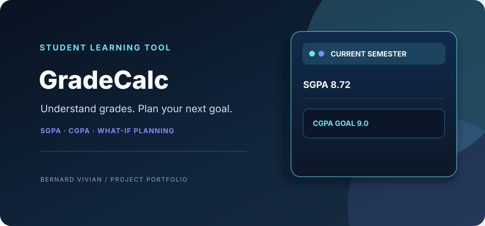
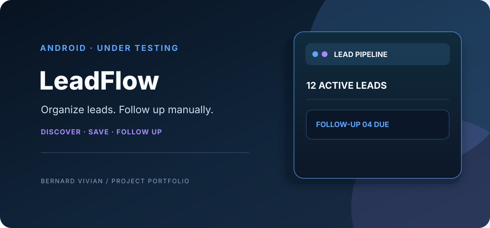
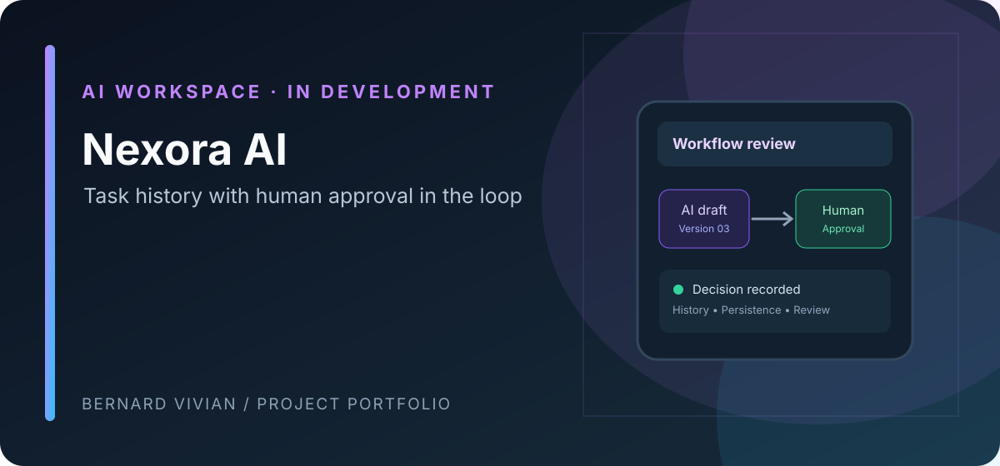
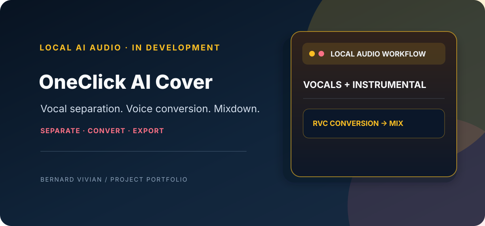
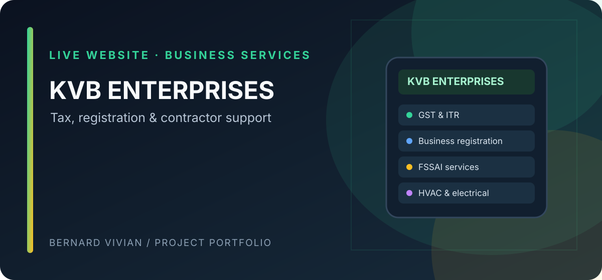

# Bernard Vivian
### Turning Everyday Needs, Ideas & Imagination into Working Software

I turn day-to-day needs, ideas, and imagination into live, working projects. I build practical web apps, Android tools, AI-assisted workflows, and business solutions—and keep improving them through testing, feedback, and real-world use.

**Current build status:** GradeCalc is improving continuously · LeadFlow is under testing · Nexora AI and OneClick AI Cover are still in development.

**Based in Puducherry, India** · [GitHub](https://github.com/ViviBeri) · [LinkedIn](https://www.linkedin.com/in/berivivi)

## Support independent open-source development

I build and maintain practical software that solves real problems—from student tools and Android apps to developer utilities and engineering-focused projects. Sponsorship helps me dedicate more time to improving these projects and keeping useful tools accessible.

  

**What your support helps fund**
- Ongoing maintenance, bug fixes, and reliability improvements
- Testing, documentation, and better onboarding for users
- Development time for new features and practical open-source tools
- Hosting and infrastructure where a project needs it

Every contribution matters—one-time encouragement and recurring support both help. Sponsorship is voluntary and supports the work; it does not buy influence over project decisions.

  Explore the projects below, then <a href="https://github.com/sponsors/ViviBeri"><strong>support the work on GitHub Sponsors</strong></a>.

---

## Project showcase

  
  

  
  

  

*Project covers are visual summaries, not screenshots of running interfaces. Open each project to explore the app or source code.*

---

## Selected work

### GradeCalc — SGPA & CGPA Calculator
A continuously improving calculator for SGC Pondicherry students. It supports credit-weighted SGPA, semester-based CGPA, grade conversion, and an installable PWA experience with offline support. I refine it day by day as I find better ways to solve students’ real needs.

- **[Open the live app](https://gradecalc-sgc.netlify.app/)**
- [Source code](https://github.com/ViviBeri/gradecalc-app)
- [Calculation tests](https://github.com/ViviBeri/gradecalc-app/blob/main/tests.js)
- **Engineering focus:** grade boundaries, credit-weighted calculations, absent/failed subjects, input validation, installability, and offline behavior.
- **Stack:** HTML, CSS, JavaScript, PWA manifest, service worker, Node.js test runner.
- **Status:** Live and actively improving.

### OneClick AI Cover — Local AI audio workflow

A free, open-source, Windows-first desktop project designed to separate vocals from a track, convert vocals with an authorized RVC voice model, remix them with the instrumental, and export audio locally—without paid APIs or cloud inference.

- [Source code](https://github.com/ViviBeri/OneClick-AI-Cover)
- [Verification plan](https://github.com/ViviBeri/OneClick-AI-Cover/blob/main/docs/verification.md)
- [Latest Windows CI run](https://github.com/ViviBeri/OneClick-AI-Cover/actions/workflows/windows-checks.yml)
- **Engineering focus:** local audio-processing workflow, Demucs vocal separation, RVC CLI integration, audio mixing/export, managed setup, and automated smoke checks.
- **Stack:** Python, Gradio, Demucs, RVC integration, FFmpeg, GitHub Actions.
- **Status:** Still in development. CI smoke checks pass, but clean-machine installer validation and complete end-to-end conversion are not yet verified. This is a local desktop application, not a hosted browser demo.

### LeadFlow — Android lead management

An Android app for managing business leads and following up through WhatsApp. It is designed around manual, user-controlled outreach, with local lead storage and export options.

- [Source code](https://github.com/ViviBeri/LeadFlow)
- **Engineering focus:** Kotlin and Jetpack Compose UI, Room database, lead search and management, CSV/XLSX/PDF export, and WhatsApp link handoff without scraping or automatic message sending.
- **Stack:** Kotlin, Jetpack Compose, Room, Android.
- **Status:** Under testing — still being validated before it is presented as a finished release.

### KVB ENTERPRISES — Business services website
A live website for a local business offering tax and registration assistance. The site includes service information, English/Tamil content, location pages, and enquiry-focused flows.

- **[Visit the live website](https://viviberi.github.io/tax-business/)**
- [Source code](https://github.com/ViviBeri/tax-business)
- **Engineering focus:** responsive static pages, service-oriented navigation, bilingual content, SEO basics, and lead-generation interactions.
- **Stack:** HTML, CSS, JavaScript, Python build tooling, GitHub Pages.

### Nexora AI — AI-assisted workspace
An AI-assisted workspace for coordinating tasks with human review, version history, and explicit approval before finalization. The current milestone includes a React/TypeScript dashboard and a FastAPI prototype with SQLite persistence.

- [Repository](https://github.com/ViviBeri/nexora-ai) *(private repository; access may be required)*
- **Engineering focus:** separating the UI and API, persistence, and keeping human approval in the workflow.
- **Stack:** React, TypeScript, FastAPI, SQLite.
- **Status:** Still in development. Full local workflow validation, authentication/authorization, and deployment hardening remain before production use.

---

## Engineering in practice

I prefer evidence in the code over long lists of technology badges. Examples from the projects above:

- **Frontend delivery:** build and maintain responsive web interfaces with HTML, CSS, and JavaScript.
- **Offline-first behavior:** use a PWA manifest and service worker to support installation and offline use in GradeCalc.
- **Calculation correctness:** maintain automated tests for grade boundaries, absent/failed subjects, credit-weighted SGPA, and CGPA behavior in GradeCalc.
- **Deployment:** publish working static sites through Netlify and GitHub Pages.
- **Workflow automation:** maintain GitHub Actions workflows for repository automation.
- **Backend engineering:** develop Nexora AI with a React/TypeScript frontend and a FastAPI/SQLite backend.
- **Android app development:** build LeadFlow with Kotlin, Jetpack Compose, and Room while testing the lead-management and export workflows.
- **Local AI/audio tooling:** integrate audio-processing components in OneClick AI Cover and clearly separate CI smoke checks from full product verification.

### Tools and technologies used

**Web:** HTML · CSS · JavaScript  
**PWA & mobile:** Progressive Web Apps · Service Workers · Android app packaging  
**Backend & data:** Python · FastAPI · SQLite · TypeScript · React  
**Engineering workflow:** Git · GitHub · GitHub Actions · Node.js testing · Netlify · GitHub Pages

*These are technologies used in the projects above, not a claim of equal depth or professional certification in every tool.*

---

## How I approach projects

1. **Start with a real need** — define the user and the job the software should do.
2. **Build the smallest useful version** — prioritize the core workflow over decorative features.
3. **Validate behavior** — test important calculations and edge cases, then fix what fails.
4. **Ship and improve** — deploy the result, document limitations, and iterate based on actual use.

---

## Open-source contributions

I contribute improvements to established open-source projects through focused code changes, maintainer feedback, and verified CI checks.

### claude-locator — README troubleshooting documentation

**[PR #6: Add README troubleshooting section](https://github.com/scs0209/claude-locator/pull/6)** · <strong>Merged October 30, 2026</strong>

Added a dedicated troubleshooting section consolidating five common setup and usage issues: Option+click not reaching the server, Claude Files pane requirements, Cursor launcher selection, delayed editor tabs, and Astro 7 configuration restarts. The repository owner described it as the project's **first outside contribution** and merged it.

- **Repository:** [scs0209/claude-locator](https://github.com/scs0209/claude-locator)
- **Contribution:** Developer documentation, troubleshooting guidance, issue resolution
- **Result:** Closed [issue #4](https://github.com/scs0209/claude-locator/issues/4)
- [View merge commit](https://github.com/scs0209/claude-locator/commit/8f94447e80e75254706bfa34ac7980528e77c49c)
- **Maintainer feedback:** Added two platform-specific clarifications to the merged README.

---

### Music Assistant — Mobile app

**[PR #1295: Use artwork colors for the More button on item details](https://github.com/music-assistant/mobile-app/pull/1295)** · <strong>Merged October 31, 2026</strong>

Updated artwork-derived UI tinting for item-description actions, multidisc album headers, artist-page “View all” buttons, and the audiobook current-chapter indicator/title. The change was maintainer-approved, and Build, Compile, and Detekt checks passed.

- **Technologies:** Kotlin, Jetpack Compose
- **Contribution:** UI theming, dynamic artwork colors, component updates, review feedback, CI verification
- [View merge commit](https://github.com/music-assistant/mobile-app/commit/d4a7256c3b6a8c8ef3d30f986d4ac90e4e9c86bc)
- [Full contribution record](https://github.com/ViviBeri/ViviBeri/blob/main/OPEN_SOURCE_CONTRIBUTIONS.md)

### Home Assistant — NSW Fuel Station documentation

**[PR #50087: Add a multi-station example for NSW Fuel Station](https://github.com/home-assistant/home-assistant.io/pull/50087)** · <strong>Merged and published November 2, 2026</strong>

Added a practical YAML example for configuring four NSW fuel stations with six fuel types per station. Clarified sensor creation when price data is available and marked the sample station IDs as illustrative. The change was approved and merged by maintainer `frenck`; all eight checks passed, and the updated example is live in the official documentation.

- **Contribution:** Home Assistant integration documentation, YAML configuration, source/schema validation, review feedback, and CI verification
- [View merge commit](https://github.com/home-assistant/home-assistant.io/commit/08e4aa19177263d960b278a61770b56dc4e4be12)
- [Read the published documentation](https://www.home-assistant.io/integrations/nsw_fuel_station/)
- [Full contribution record](https://github.com/ViviBeri/ViviBeri/blob/main/OPEN_SOURCE_CONTRIBUTIONS.md)

### Contribute To This Project — Contributor card

**[PR #4820: Add ViviBeri contributor card](https://github.com/Syknapse/Contribute-To-This-Project/pull/4820)** · <strong>Merged October 25, 2026</strong>

Added the ViviBeri contributor card to the project's contributor showcase. The automated workflow validated the submission and merged it into the project's main branch.

- **Contribution:** Open-source contributor profile/card submission
- **Result:** Merged successfully; contributor card accepted by the project
- [View the contributor showcase](https://syknapse.github.io/Contribute-To-This-Project)

---

## GitHub activity

My contribution graph is retained below. Automated activity visualizations are supplementary; the projects and their source code above are the primary evidence of my work.

<!-- Contribution Snake: keep the existing green contribution animation -->

  

---

## Contact

I'm interested in practical web and mobile projects, useful developer tools, and collaborations where clear implementation and reliability matter.

- [Connect on LinkedIn](https://www.linkedin.com/in/berivivi)
- [Browse all repositories](https://github.com/ViviBeri?tab=repositories)
