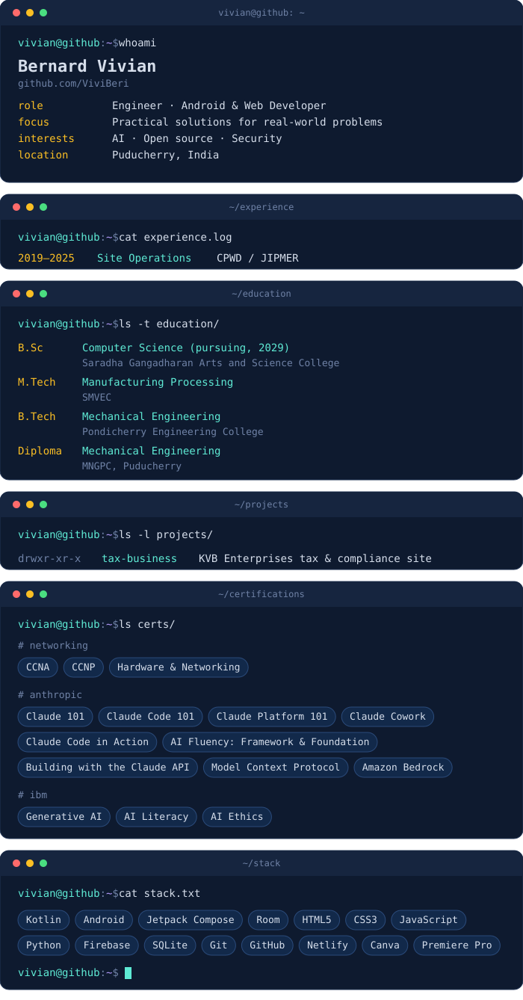
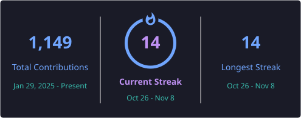

<h1>Vivian · ViviBeri</h1>

<strong>Engineer · Android & Web Developer · Local-first AI</strong>

  <a href="https://github.com/ViviBeri">GitHub</a> ·
  <a href="https://linkedin.com/in/berivivi">LinkedIn</a> ·
  <a href="https://viviberi.github.io/tax-business/">KVB Enterprises</a> ·
  Pondicherry, India

---

## `whoami`

  

I bring a practical engineering mindset to software. My background spans mechanical and manufacturing engineering, HVAC and electrical infrastructure, and IT operations. I build useful Android and web tools, explore local-first AI, and care about systems that are understandable, testable, and dependable.

> **My approach:** Understand the real problem. Build the useful solution. Verify it.

## Featured builds

| Project | Focus | Status |
|---|---|---|
| [Nexora AI](https://github.com/ViviBeri/nexora-ai) | Human-reviewed workflows and local-first AI | In development |
| [OneClick AI Cover](https://github.com/ViviBeri/OneClick-AI-Cover) | Local audio workflow: separation, RVC conversion and export | In development |
| [LeadFlow](https://github.com/ViviBeri/LeadFlow) | Android lead discovery and management for local businesses | Under testing |
| [GradeCalc](https://github.com/ViviBeri/gradecalc-app) · [Live demo](https://gradecalc-sgc.netlify.app/) | Offline-capable SGPA and CGPA calculator | Live · Improving |
| [KVB Enterprises](https://viviberi.github.io/tax-business/) | Tax, registration, compliance and technical services | Live |

## Engineering tools and references

These repositories extend my work beyond application development into building-services and electrical engineering:

| Repository | What it covers |
|---|---|
| [FreeCAD-HVAC](https://github.com/ViviBeri/FreeCAD-HVAC) | Parametric HVAC duct-network modeling, fitting generation, pressure-drop calculations, and automatic duct sizing in FreeCAD. |
| [MEP Design Sheets](https://github.com/ViviBeri/MEP-Design-Sheets) | Practical calculation sheets and references for HVAC, electrical, plumbing, lighting, lifts, and other building services. |
| [GElectrical contribution](https://github.com/ViviBeri/GElectrical) | Contributions to open-source LV/MV electrical distribution analysis; [PR #24](https://github.com/manuvarkey/GElectrical/pull/24) adds a Pandapower JSON import viewer and remains under review. |
| [Earthing fork](https://github.com/ViviBeri/Earthing) | Maintained fork of an electrical-substation grounding analysis library; upstream remains [manuvarkey/Earthing](https://github.com/manuvarkey/Earthing). |

## Open-source contributions

I contribute documentation, Android UI improvements, developer tooling, and engineering features to projects maintained by other teams.

### Merged contributions

- **Home Assistant:** [PR #50087](https://github.com/home-assistant/home-assistant.io/pull/50087) — added a multi-station NSW Fuel Station configuration example; merged and published.
- **Music Assistant Mobile:** [PR #1295](https://github.com/music-assistant/mobile-app/pull/1295) — improved artwork-derived colors across item-detail controls; merged after maintainer approval.
- **claude-locator:** [PR #6](https://github.com/scs0209/claude-locator/pull/6) — added developer troubleshooting documentation; merged by the maintainer.
- **Contribute To This Project:** [PR #4820](https://github.com/Syknapse/Contribute-To-This-Project/pull/4820) — added my contributor card to the community showcase.

### Currently under review

- **Home Assistant documentation:** [#50141](https://github.com/home-assistant/home-assistant.io/pull/50141), [#50415](https://github.com/home-assistant/home-assistant.io/pull/50415), [#50418](https://github.com/home-assistant/home-assistant.io/pull/50418), [#50419](https://github.com/home-assistant/home-assistant.io/pull/50419), and [#50420](https://github.com/home-assistant/home-assistant.io/pull/50420).
- **GElectrical:** [PR #24](https://github.com/manuvarkey/GElectrical/pull/24) — Pandapower JSON import viewer.
- **Home Assistant Core:** [ViviBeri/core PR #1](https://github.com/ViviBeri/core/pull/1) — Ring camera integration work.

Only merged items are described as completed contributions; open pull requests remain clearly marked as under review.

## Engineering focus

- **Local-first AI:** useful tools with transparent processing and user control.
- **Human-reviewed automation:** traceable changes, approval steps, and reversible workflows.
- **Android and web apps:** practical products designed around real user workflows.
- **Engineering quality:** focused tests, CI, clear documentation, and incremental delivery.

## Toolbox

## Engineering foundation

**M.Sc. Manufacturing Processing** · **B.Tech Mechanical Engineering** · **Diploma in Mechanical Engineering**

Additional coursework: IBM Cybersecurity and Generative AI.

## Activity

## Build notes

- [LeadFlow — local business discovery on Android](https://github.com/ViviBeri/LeadFlow/blob/main/docs/BUILD_LOG_01_LOCAL_BUSINESS_DISCOVERY.md)
- [OneClick AI Cover — local AI audio workflow](https://github.com/ViviBeri/OneClick-AI-Cover/blob/main/docs/BUILD_LOG_01_LOCAL_AI_AUDIO_WORKFLOW.md)
- [GradeCalc — offline academic calculator](https://github.com/ViviBeri/gradecalc-app/blob/main/docs/BUILD_LOG_01_OFFLINE_ACADEMIC_CALCULATOR.md)

---

**Practical engineering. Useful software. Continuous improvement.**

