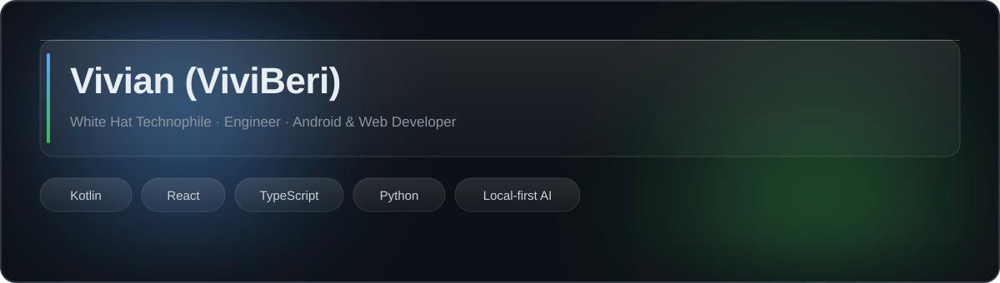
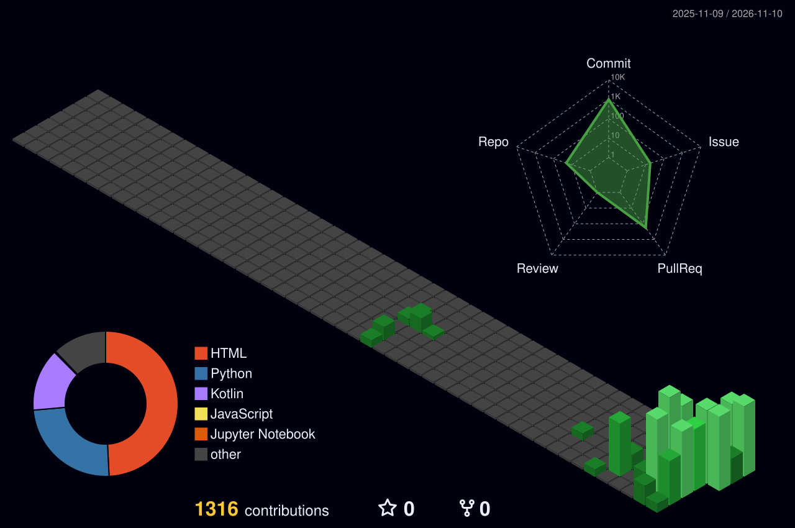

# Hi there 👋

## Mission

I turn messy, real-world operational problems into clean, reliable software systems. My background in large-facility operations, HVAC, electrical infrastructure, and IT administration shapes how I build Android apps, web tools, automation, and local-first AI: understand the process, design for failure, validate the behavior, and improve what ships. I value dependable systems over polished demos.

## 🚀 Featured Projects

| Project | Description | Tech |
|---|---|---|
| [Nexora AI](https://github.com/ViviBeri/nexora-ai) | Human-reviewed task workspace exploring revision history, workflow coordination, and local-first AI. | Python · Local-first AI |
| [OneClick AI Cover](https://github.com/ViviBeri/OneClick-AI-Cover) | Local-first Windows workflow for vocal separation, RVC conversion, mixing, and export. | Python · Demucs · RVC · Audio tooling |
| [LeadFlow](https://github.com/ViviBeri/LeadFlow) | Android lead discovery and management workflow for local businesses. | Kotlin · Jetpack Compose · Room |
| [GradeCalc](https://github.com/ViviBeri/gradecalc-app) | Offline-capable PWA for SGPA, CGPA, and academic planning. | HTML · CSS · JavaScript · PWA |
| [KVB Enterprises](https://viviberi.github.io/tax-business/) | Business services for tax, registration, compliance, HVAC, and electrical support. | React · TypeScript · Python |

## 🧪 Currently Building

- **Local-first AI workflows:** practical AI tools that keep processing and user control close to the machine.
- **Human-in-the-loop orchestration:** traceable task revisions, review, and approval rather than opaque automation.
- **Android business tooling:** improving lead discovery, local data handling, and offline-friendly workflows.
- **Reliable delivery:** testing, CI automation, documentation, and maintainable releases across projects.

## ✨ Live GitHub Activity

## 🛠️ Tech Stack & Tools

**Languages and web**

**Frameworks, platforms and engineering**

## ⚙️ Engineering Foundation

**M.Sc. Manufacturing Processing** · **B.Tech Mechanical Engineering** · **Diploma in Mechanical Engineering**  
Additional coursework: **IBM Cybersecurity** and **Generative AI**.

I bring a mechanical and operations-engineering perspective to software: understand the real process, identify failure points, build a workable system, test it, and keep improving it.

## 📊 GitHub Stats

## 📫 Connect

---

*Practical engineering. Useful software. Continuous improvement.*

